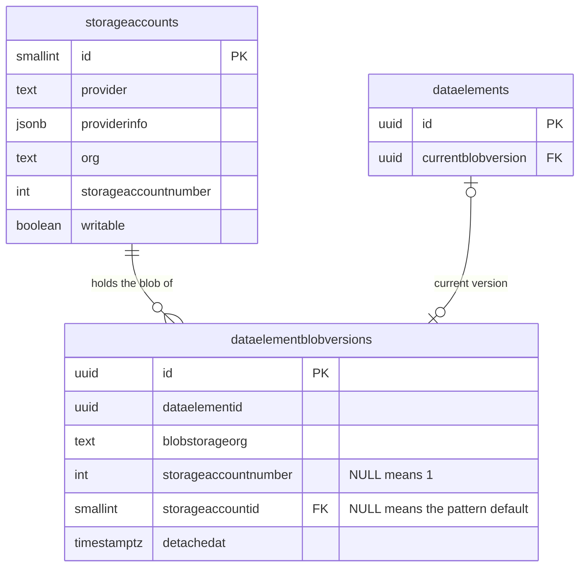
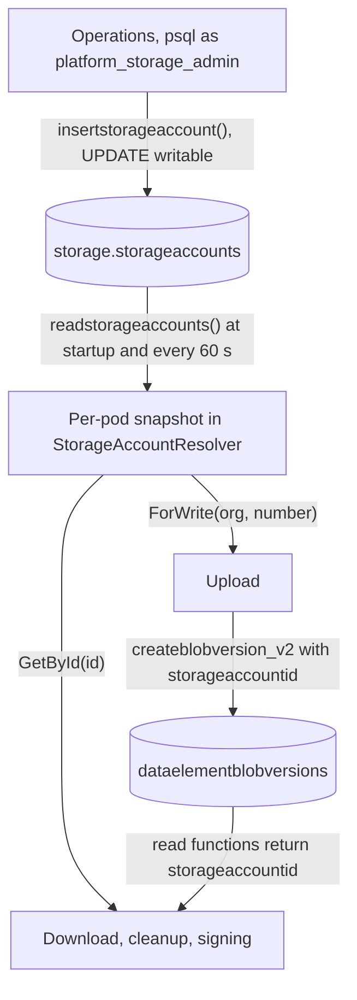
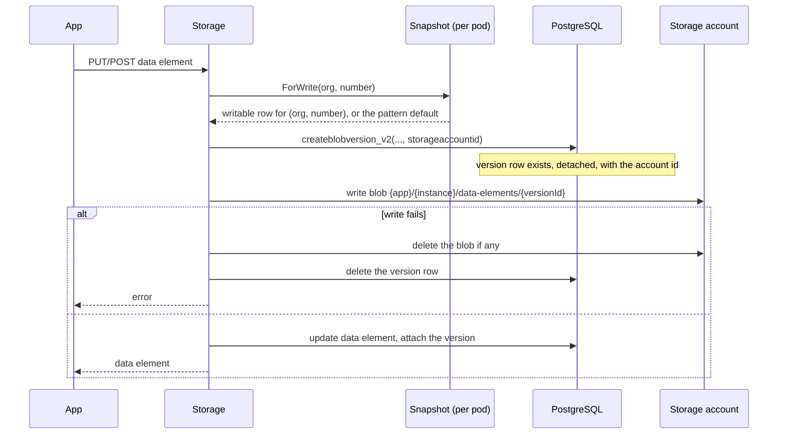
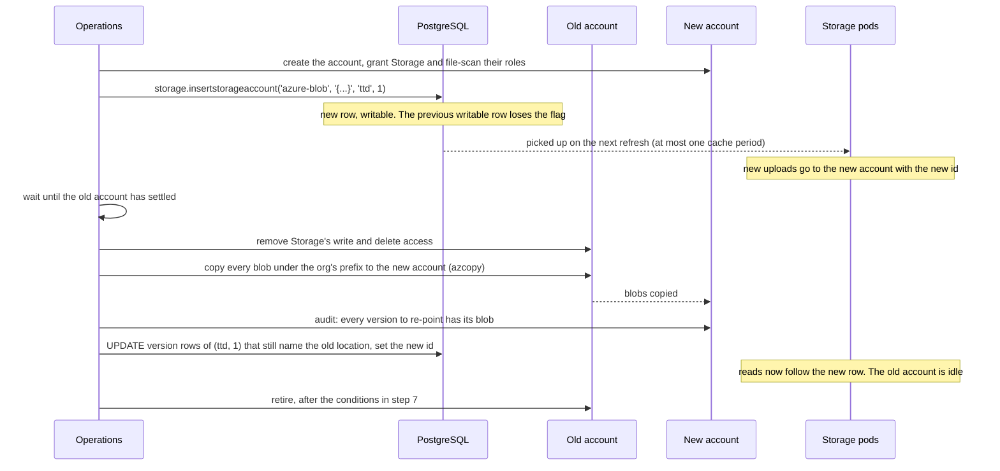

# Storage accounts per blob version

Storage keeps every data element blob in a storage account that belongs to the application owner.
Until now the account was derived at runtime from a naming pattern. From migration v0.39 the table
`storage.storageaccounts` can name an account explicitly, and every new blob version records which
account holds its blob. This document describes how the table is used.

## The table

```sql
CREATE TABLE storage.storageaccounts (
    id SMALLINT GENERATED ALWAYS AS IDENTITY PRIMARY KEY,
    provider TEXT NOT NULL,                 -- 'azure-blob'; selects the C# type
    providerinfo JSONB NOT NULL,            -- that provider's own properties
    org TEXT NOT NULL,                      -- blob storage org
    storageaccountnumber INT NOT NULL,      -- Application.StorageAccountNumber, 1 when the app has none
    writable BOOLEAN NOT NULL DEFAULT true, -- receives new blob versions of (org, number)
    created TIMESTAMPTZ NOT NULL DEFAULT NOW()
);
CREATE UNIQUE INDEX storageaccounts_writable
    ON storage.storageaccounts (org, storageaccountnumber) WHERE writable;
```

A row is a location, never a credential. The `azure-blob` document names only the account and the
container; the service derives the URL from the account name and authenticates with its own
workload identity. A document with any other key is rejected.

| provider | providerinfo | How the service reaches it |
| --- | --- | --- |
| `azure-blob` | `{"accountName":"ttdaltinnprodstrg01","container":"ttd-prod-appsdata-blob-db"}` | `https://{accountName}.blob.core.windows.net/{container}` with the pod's workload identity, which needs the Storage Blob Data Contributor role on the account. The Azurite account `devstoreaccount1` uses the endpoint and shared key from `AzureStorageConfiguration`. |

`azure-blob` is the only provider this release knows. A row with any other provider is unreadable
(see [The cache](#the-cache)). The `provider` column exists so that later releases can add providers
without changing the document format.

Rows are immutable except for `writable`. An id, once handed out, always means the same location.



## Two ways to name an account

Every blob version is located in one of two ways.

- **By row.** `storageaccountid` on the version row points at a `storageaccounts` row. The blob is in
  the location that row describes.
- **By pattern.** `storageaccountid` is `NULL`. The account name is built from the configured pattern
  (`AzureStorageConfiguration:OrgStorageAccount` and `OrgStorageContainer`) and the version row's own
  `blobstorageorg` and `storageaccountnumber`, exactly as before v0.39. This is called the *pattern
  default* in the code.

The pattern default covers every blob written before v0.39 and every blob written for an
`(org, number)` pair that has no writable row. Nothing is backfilled, so the pattern default stays
in use until a later task re-points the old rows.

Legacy blobs that have no version row (data elements with `currentblobversion IS NULL`) are always
read from the pattern default.

## Who touches the table



Only operations write the table, with SQL. The service reads it, never writes it. Every version row
written through `createblobversion_v2` carries the id of the account the blob went to.

## The cache

Each pod reads the whole table into memory, at startup and again when the snapshot is older than
`GeneralSettings:StorageAccountCacheSeconds` (default 60). The snapshot is small: one row per account
owned by a service owner, tens of rows at most. No request reads the table directly, and requests
that find the snapshot expired at the same time share one read.

- **Reads are always correct.** Rows are immutable, so a cached row describes the right location for
  as long as the pod runs. An id that is not in the snapshot (a row inserted after the last refresh)
  triggers one refresh, and only then an error if it still does not exist.
- **Writes may lag by one cache period.** After operations insert a writable row, pods that have not
  refreshed yet still send new uploads to the previous target. That is harmless: each version row
  records where its blob actually went, so reads and cleanup follow it. The lag is also short compared
  with an upload, so an exact cut-over time is not needed.
- **An unreadable row never stops the pod.** A row whose `provider` this build does not know, or
  whose document fails validation, is logged as critical at startup and on every refresh. Only the
  operations that need that row fail: reads of blobs in that account, and uploads for its
  `(org, number)` while it is writable. They never fall back to the pattern default, because the
  pattern account does not hold those blobs. A request that needs the row fails with 500 before it
  changes anything; a download, for example, does not mark the element as read. Cleanup skips the
  data elements and orphaned versions in that account, cleans up the rest, and then reports 500.

## Resolving the account of a blob


The read functions `readdataelement_v3` and `readinstance_v3` join the current version row and return
`storageaccountid`, `blobstorageorg` and `storageaccountnumber` next to the element, so a download
needs no second query. The paged instance list does not load them; an element taken from the list
cannot be used to read a blob, and the resolver refuses it.

Downloads of a specific version (`GET .../data/{id}/versions/{versionId}`), cleanup of detached and
orphaned versions, hard delete, signing and the A2 migration paths all resolve the same way from the
version row they already hold.

## Writing a new blob version



The account is chosen once, before the version row is created, and the row and the blob always
agree. `number` is `Application.StorageAccountNumber`, or 1 when the application has none. With no
writable row for the pair, `storageaccountid` is `NULL` and the blob goes to the pattern default,
which is the behaviour of every environment until operations insert a row.

The file-scan queue message carries the provider name and document of the account the blob was
written to, so the scanner reads from the same location.

## Cleanup

Detached versions, versions orphaned for more than seven days and hard-deleted data elements are
cleaned up per account. The cleanup readers return the version rows grouped by
`(blobstorageorg, storageaccountnumber, storageaccountid)`, and each group is deleted from its own
account. A data element that was overwritten before and after a move therefore has its old versions
deleted from the old account and the new ones from the new account.

The previous release's cleanup functions skip rows with a non-null `storageaccountid`, so a rolling
deploy never deletes from the wrong account.

A data element or orphaned version group whose account cannot be resolved, or whose cleanup fails
for another reason, is skipped and retried on the next run. The run cleans up everything else and
returns 500 when anything was skipped.

Deleting an instance always deletes the instance's prefix from the pattern default account first,
because legacy blobs without a version row can only be there. If that account is gone or Storage
has lost access to it, the instance is not deleted. See step 6 of the move procedure below.

## Rolling back

A release older than v0.39 reads every blob from the pattern default. Rolling back is safe while
`storage.storageaccounts` is empty. Once a row is inserted and versions are written to it, the old
release cannot download those versions: it looks for them in the pattern account and returns not
found. Roll forward instead, or copy those blobs to the pattern default account and re-point their
versions to it before rolling back.

## Moving an owner's blobs to a new account

Because reads follow the version row, a move is a copy followed by a re-point. Both accounts can
receive writes at the same time while the move is under way: every version row records where its
blob went, so reads and cleanup stay correct. What the procedure must get right is the moment when
the old account no longer receives new blobs, since only blobs that are in the old account at the
final copy reach the new one.

The old account can still receive new blobs after the new row is inserted:

- **Requests already running.** An upload chooses its account when it starts and writes the blob
  to that account, however long the upload takes. The mutations API accepts request bodies of up
  to 2000 MB and keeps staged blobs until it commits.
- **Pods with an older snapshot,** for up to `StorageAccountCacheSeconds`. A pod never uses a
  snapshot older than that: when a refresh fails, the request fails.
- **Pods of a release older than v0.39,** which ignore the table. Never start a move during a
  deploy that includes such a release.

The old account has *settled* when the insert is older than the cache period plus the longest
possible request. Only then is a copy complete.



1. **Create the account** and give Storage's workload identity and file-scan's identity the Storage
   Blob Data Contributor role on it.
2. **Insert the row.** `storage.insertstorageaccount` takes the writable flag over from the previous
   row for the pair in the same transaction. From the next cache refresh, new versions land in the
   new account. To set the flag on an existing row instead, clear it on the previous row and set it
   on the new one in a single transaction; the unique index `storageaccounts_writable` rejects two
   writable rows for a pair.
3. **Wait until the old account has settled:** at least `StorageAccountCacheSeconds` plus the longest
   request after the insert. An early copy can be made in the meantime to shorten the final one.
4. **Make the old account read-only for Storage.** Remove Storage's write and delete access, keeping
   read access. An upload that still reaches the old account then fails, and orphan cleanup
   later removes its detached version row, instead of a blob landing there that the final copy
   misses. Cleanup cannot delete from the old
   account while it is read-only: those deletes fail and are retried after the re-point, against the
   new account. Without this, a blob that cleanup deletes after it was copied stays in the new
   account forever. Hard-delete cleanup reports 500 for the skipped elements until the move is done.
5. **Copy the blobs and audit.** The versioned blob path is the same in every account, so the copy is
   a prefix copy. Then confirm that every version to be re-pointed has its blob in the new account.
6. **Re-point the version rows** in batches. The condition on `storageaccountid` keeps the update to
   rows that still name the old location (`NULL` for the pattern default), so rows written to the new
   account are not touched. Every read of those elements now goes to the new account, and cleanup
   deletes from it.
7. **Retire the old account.** Remove Storage's access or delete the account only when nothing is
   read from it any more. A pattern default account is still used after its versions are re-pointed:
   legacy non-versioned blobs are read from it, and instance cleanup deletes from it for every
   instance of the org. Before a pattern default account is retired, its legacy blobs must be
   converted to versions, and instance cleanup must stop depending on it; this release has no
   support for either.

Rows are never deleted. A row that no longer receives writes and has no versions pointing at it is
simply unused.

## SQL for operations

```sql
-- Register an account that receives new versions for (ttd, 1).
SELECT storage.insertstorageaccount(
    'azure-blob',
    '{"accountName":"ttdaltinnprodstrg02","container":"ttd-prod-appsdata-blob-db"}'::jsonb,
    'ttd', 1);

-- List the accounts.
SELECT * FROM storage.readstorageaccounts();

-- Where the versions of (ttd, 1) are today; NULL is the pattern default.
-- Scans the version table: run off-peak or on a replica.
SELECT storageaccountid, count(*)
FROM storage.dataelementblobversions
WHERE blobstorageorg = 'ttd' AND COALESCE(storageaccountnumber, 1) = 1
GROUP BY storageaccountid;
```

Before the first row is inserted in an environment where file scanning is on, the scanner must be
released with support for the location in the queue message and verified end to end against a blob
in a named account.
